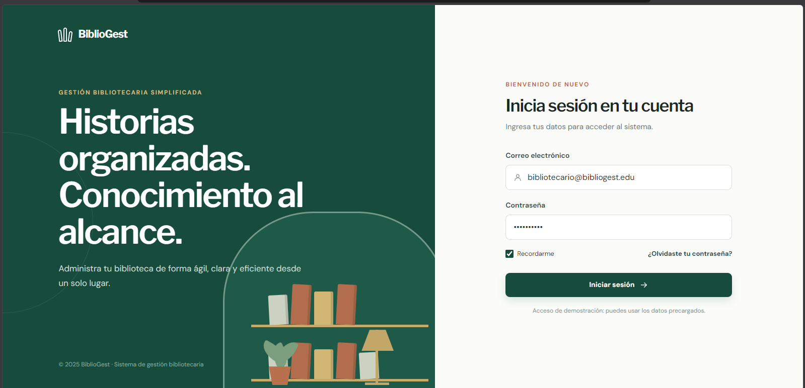
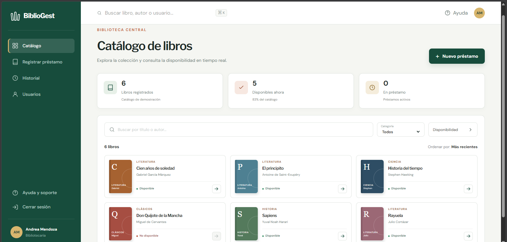
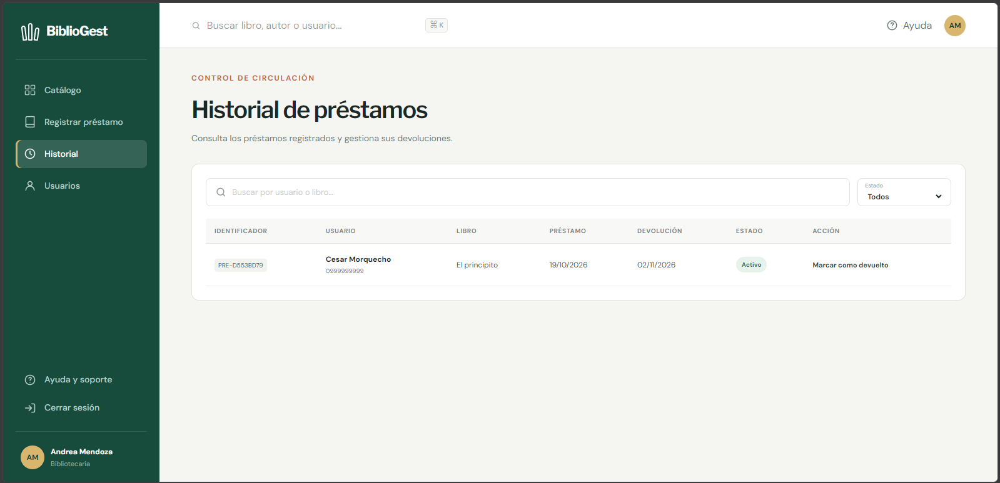

# Evidencias de Figma – BiblioGest

## Descripción
En esta carpeta se encuentran las capturas de las tres pantallas principales del prototipo BiblioGest, desarrollado mediante Figma Make para la Práctica N.º 2 de Construcción de Software de la UNEMI.

## Pantallas diseñadas

### 1. Inicio de sesión
Interfaz para ingresar al sistema mediante usuario y contraseña, con validaciones de acceso simuladas.

### 2. Catálogo de libros disponibles
Pantalla que permite consultar y buscar libros, visualizar su información y comprobar su disponibilidad.

### 3. Registro de préstamos
Formulario para seleccionar un usuario y un libro, establecer las fechas y simular el registro del préstamo.

## Herramienta utilizada
Figma Make AI.

## Enlace del prototipo
[Ver prototipo de BiblioGest](https://www.figma.com/make/I2fa0UF6AFHJTP0enIGFzu/BiblioGest-Interface-Design?t=Kh635XUlzPdl6Hx9-1)
[Ver prototipo de Web](https://essay-shout-94196502.figma.site/)
