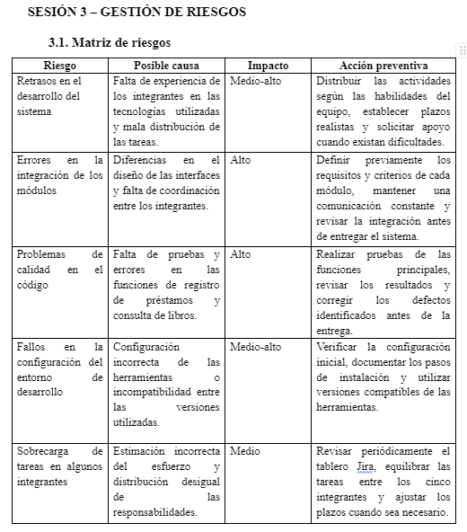

# Evidencias de gestión de riesgos – BiblioGest

## Descripción
En esta carpeta se presenta la matriz de riesgos correspondiente a la Sesión 3 de la Práctica N.º 2 de Construcción de Software de la Universidad Estatal de Milagro (UNEMI).

El objetivo es identificar posibles dificultades durante el desarrollo del sistema BiblioGest y establecer acciones preventivas para reducir su impacto.

## Riesgos identificados

1. **Retrasos en el desarrollo del sistema:** falta de experiencia y distribución inadecuada de tareas. Impacto medio-alto.
2. **Errores en la integración de módulos:** diferencias en el diseño y falta de coordinación. Impacto alto.
3. **Problemas de calidad en el código:** falta de pruebas y defectos en las funciones. Impacto alto.
4. **Fallos en la configuración del entorno:** configuración incorrecta o incompatibilidad de herramientas. Impacto medio-alto.
5. **Sobrecarga de tareas:** estimación incorrecta del esfuerzo y distribución desigual. Impacto medio.

## Matriz de riesgos

## Herramientas utilizadas
- Microsoft Word para elaborar la matriz.
- GitHub para almacenar las evidencias.

La matriz incluye el riesgo, su posible causa, nivel de impacto y acción preventiva.
