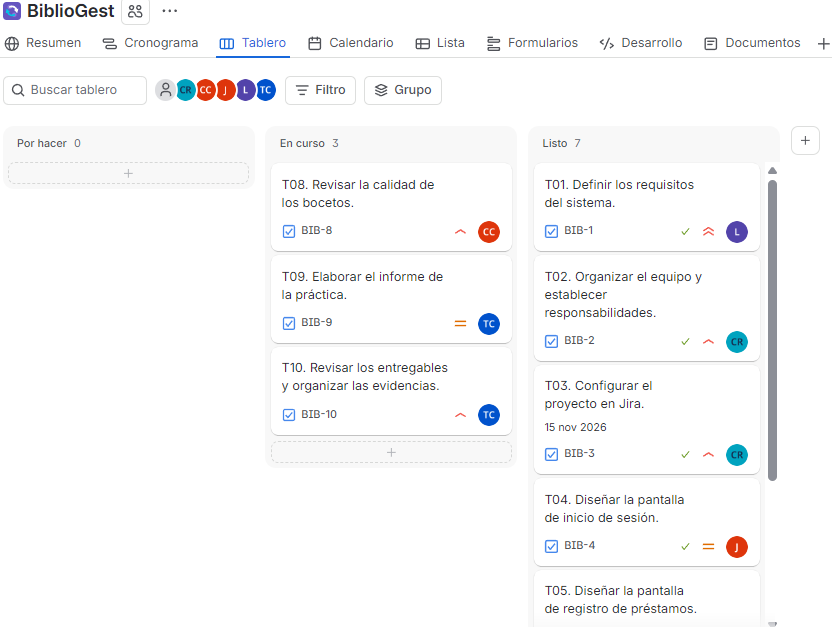
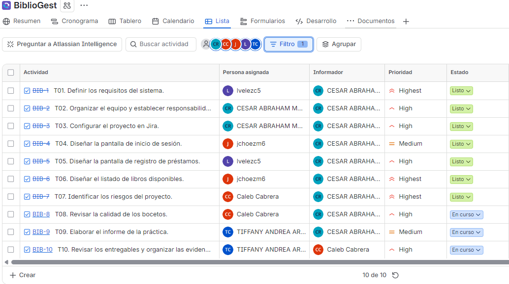
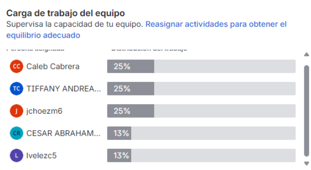

# Evidencias de Jira – BiblioGest

## Descripción
En esta carpeta se presentan las evidencias de la planificación y organización de las actividades del proyecto BiblioGest mediante Jira Software.

## Metodología utilizada
Se utilizó Kanban, organizando las diez tareas del proyecto en tres columnas:
- Por hacer
- En curso
- Listo

## Tablero Kanban

## Lista de actividades

## Carga de trabajo

## Proyecto Jira
[Consultar tablero BiblioGest](https://construcciondesoftware.atlassian.net/jira/software/projects/BIB/boards/69?filter=&groupBy=none&atlOrigin=eyJpIjoiMDdkZmIxNTAzNzc4NDI5NDgyMjY5YTk0NjUyM2NiYjIiLCJwIjoiaiJ9)

Las capturas documentan el estado del proyecto en el momento de su realización.
